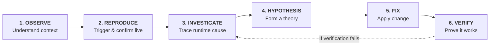

# Investigation Loop Skill 🔬

> **"Stop describing bugs to agents. Give them access to the running system and let them investigate."**

This skill guides agents through a rigorous, evidence-driven 6-stage diagnostic loop. It prevents the most common agent failure modes: guessing root causes from static code, skipping live reproduction, falling for red herrings, and stopping before verifying fixes at runtime.

---

## 1. OBSERVE — Understand Context & Environment

**Rule:** Read the bug report carefully to identify the expected vs actual behavior and the target environment before touching code.

- **Action Checklist:**
  1. Identify the reported symptom, affected component/page, and user action flow.
  2. Note required environment conditions:
     - Target viewport (e.g. desktop `1280px` vs mobile `390px`).
     - Network profile (e.g. Fast 3G, Slow 3G, or offline).
     - User auth / permissions or test data state.

---

## 2. REPRODUCE — Trigger & Confirm the Issue Live

**Rule:** NEVER guess the problem from static code alone. Always actively reproduce the bug in the running browser first to confirm the failure mode.

- **Action Checklist:**
  1. Open or navigate to the active browser session.
  2. Set up the matching viewport (`resize_page`) or throttling profile if needed.
  3. Execute the exact user actions / clicks / form inputs described in the report.
  4. Capture initial proof:
     - Take a screenshot of the broken UI state.
     - Confirm that the visual bug, broken element, or error banner is actively visible.

---

## 3. INVESTIGATE — Trace the Runtime Cause

**Rule:** Inspect DevTools runtime evidence (Network, Console, DOM, computed styles) to locate where reality diverges from expectation.

- **Action Checklist:**
  1. **Network Errors:**
     - List network requests and filter by failed status codes (`404`, `400`, `409`, `500`, CORS).
     - Inspect the request payload (`body`, headers, URL parameters).
     - Inspect the response body and status code (e.g. backend error messages or stack traces).
  2. **Console & Runtime Exceptions:**
     - List console messages (unhandled errors, uncaught promises, warnings).
  3. **Visual & Clickability Issues:**
     - Inspect DOM tree bounding boxes and computed CSS rules (`z-index`, `pointer-events`, `overflow: hidden`, fixed overlays).
     - Check if an overlay or parent element is intercepting clicks or clipping content.
  4. **State / Persistence Issues:**
     - Check whether an action triggers an API request or only updates local component state.
     - Verify what the API response actually returns vs what the UI displays.
  5. **Concurrency / Race Conditions:**
     - Check if multiple fast clicks produce duplicate network requests.
     - Inspect button state (disabled vs clickable during in-flight requests).

---

## 4. HYPOTHESIS — Form a Theory & Rule Out Red Herrings

**Rule:** State the hypothesis clearly, connecting runtime evidence to source code. Explicitly evaluate and rule out red herrings.

- **Structure of a Strong Hypothesis:**
  - *"The bug occurs because [SPECIFIC CAUSE] in [FILE/FUNCTION]."*
  - *"Runtime evidence supporting this: [HTTP status / console error / DOM element / screenshot]."*
  - *"Red herrings ruled out: [Plausible code smells in static code that are NOT the cause]."*

---

## 5. FIX — Apply Minimal Targeted Change

**Rule:** Implement the minimal, targeted change addressing the verified root cause.

- **Guidelines:**
  - Do not refactor unrelated code or alter clean components.
  - Fix both the root cause and any misleading UI state (e.g., disable buttons during in-flight requests, handle error states gracefully instead of masking them).

---

## 6. VERIFY — Prove It Works Under Matching Conditions

**Rule:** A bug is NOT fixed when code is written. It is fixed ONLY when proven in the live running application under the exact conditions where it originally failed.

- **Action Checklist:**
  1. Re-run the reproduction steps in the running browser.
  2. Test under the **same environment conditions**:
     - Same mobile viewport (e.g. 390px).
     - Same network throttling / rapid multi-click actions.
     - Same page reload test to prove state persistence.
  3. Capture fresh runtime proof:
     - Clean console (zero unexpected errors).
     - Network tab showing successful HTTP 200 responses.
     - Visual screenshot confirming the fixed layout.
  4. **If verification fails:** Do NOT guess again. Feed the new runtime evidence back into **Step 3 (Investigate)** and update your hypothesis.
